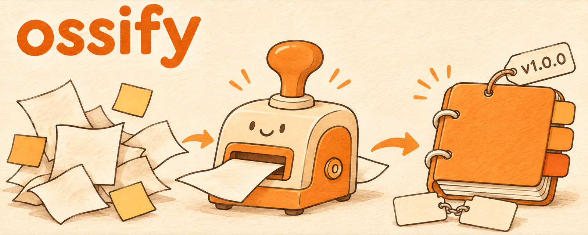

<p align="center">
  
</p>

<p align="center">
  <a href="README.md">English</a> · <b>한국어</b>
</p>

# ossify

**모든 저장소에 같은 오픈소스 규칙을, 에이전트가 한 번에 세팅.**

ossify는 Claude Code와 Codex용 에이전트 스킬입니다. 저장소에 세 가지를 넣어 줍니다. `AGENTS.md`와 그걸 가리키는 `CLAUDE.md` 심볼릭 링크로 된 에이전트 규칙, 버전 올림·태그·GitHub 릴리스로 이어지는 릴리스 절차, 같은 구조로 쓴 영어·한국어 README입니다.

## 왜 만들었나

오픈소스 저장소를 새로 만들 때마다 같은 세팅이 필요했습니다. 에이전트한테 수정할 때마다 커밋하고 push하라고 알려주고, 배포되는 코드가 바뀔 때만 릴리스하고, 태그는 일정하게 달고, 영어·한국어 README를 맞춰 두는 일입니다. 매번 손으로 쓰다 보니 저장소마다 조금씩 달라졌습니다. ossify는 매번 같은 방식으로 씁니다.

## 하는 일

| 모드 | 언제 | 결과 |
|---|---|---|
| init | 새 저장소, 빈 폴더 | `AGENTS.md`, `CLAUDE.md -> AGENTS.md`, README, 배너, LICENSE, CHANGELOG, .gitignore, 첫 커밋 |
| adopt | 이미 있는 저장소 | 같은 파일을 기존 내용과 합쳐서 추가. 확인 없이 덮어쓰지 않음 |
| readme | "README 써줘" | 언어 전환 링크가 있는 `README.md`와 `README.ko.md`, 내용 동기화 |
| release | 배포 대상이 바뀐 뒤 | 모든 버전 파일의 버전 올림, CHANGELOG, 태그, GitHub 릴리스 |

ossify가 쓰는 `AGENTS.md`는 이후 모든 에이전트에게 이렇게 알려줍니다.

1. 수정할 때마다 커밋하고 push한다.
2. 배포 대상이 바뀔 때만 릴리스한다. 버전을 한 단계 올리고, CHANGELOG를 쓰고, 태그를 달고, GitHub 릴리스를 만든다.
3. 문서만 바뀌면 릴리스하지 않는다.
4. `README.md`와 `README.ko.md`를 항상 같이 고친다.
5. 배포 대상을 커밋하기 전에 검증한다.
6. 비밀값이나 개인정보는 커밋하지 않는다.

프로젝트 종류(Claude Code 플러그인, npm, Python, Rust, Go, Swift, 기타)를 알아내서 버전 파일과 배포 대상 경로를 정합니다.

## 예시

이 규칙을 쓰는 저장소들입니다.

- [nathankim0/ssul](https://github.com/nathankim0/ssul): 한국어 SNS 글쓰기 스킬
- [nathankim0/skill-alloy](https://github.com/nathankim0/skill-alloy): 오픈소스 스킬을 하나로 합치는 스킬. 패키징과 릴리스는 ossify에 맡김
- 이 저장소

```text
/ossify init
/ossify release
```

## 필요한 것

- 로그인된 [GitHub CLI](https://cli.github.com/) (`gh auth status`)
- 배너용: 이미지 생성이 켜진 [Codex CLI](https://github.com/openai/codex) 또는 `OPENAI_API_KEY`. 둘 다 없으면 배너 없이 README를 씁니다.

## 설치

### Claude Code (플러그인)

```text
/plugin marketplace add nathankim0/ossify
/plugin install ossify@ossify
```

### Claude Code 또는 Codex (직접 복사)

```bash
git clone https://github.com/nathankim0/ossify.git
cp -R ossify/skills/ossify ~/.claude/skills/ossify   # Claude Code
cp -R ossify/skills/ossify ~/.codex/skills/ossify    # Codex
```

### Agent Skills를 지원하는 에이전트

```bash
npx skills add nathankim0/ossify
```

## 사용법

```text
/ossify init                 새 저장소 세팅
/ossify adopt                기존 저장소에 규칙 추가
/ossify readme               README 작성·동기화
/ossify release              다음 릴리스
```

그냥 말로 해도 됩니다: "AGENTS.md 만들어줘", "릴리스 해줘", "README 써줘".

## 구성

```text
skills/ossify/SKILL.md               절차 본문
skills/ossify/references/
  agents-template.md                 AGENTS.md 템플릿과 심볼릭 링크 메모
  readme-rules.md                    README 구조, 작성 규칙, 배너 생성
  release.md                         버전 규칙, CHANGELOG, 태그, GitHub 릴리스, 확인
  project-types.md                   프로젝트 종류별 버전 파일과 배포 대상 경로
.claude-plugin/                      Claude Code 플러그인·마켓플레이스 매니페스트
```

## 라이선스

[MIT](LICENSE)
