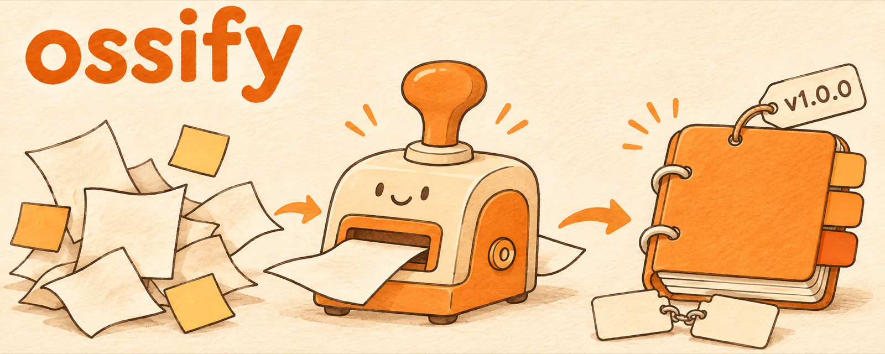

<p align="center">
  
</p>

<p align="center">
  <b>English</b> · <a href="README.ko.md">한국어</a>
</p>

# ossify

**The same open-source conventions in every repo, set up by your agent in one pass.**

ossify is an agent skill for Claude Code and Codex. It gives a repo three things: agent rules in `AGENTS.md` with a `CLAUDE.md` symlink, a release routine with version bumps, tags, and GitHub releases, and English and Korean READMEs written to one structure.

## Why it exists

Every new open-source repo needed the same setup: tell agents to commit and push after each change, release only when the shipped code changes, tag consistently, and keep an English and a Korean README in sync. Writing that by hand each time drifted. ossify writes it the same way every time.

## What it does

| Mode | When | Result |
|---|---|---|
| init | new or empty repo | `AGENTS.md`, `CLAUDE.md -> AGENTS.md`, READMEs, banner, LICENSE, CHANGELOG, .gitignore, first commit |
| adopt | existing repo | the same files, merged with what is already there; nothing is overwritten blindly |
| readme | "write the README" | `README.md` and `README.ko.md` with a language switch, synced |
| release | after a distribution change | version bump in every version file, CHANGELOG, annotated tag, GitHub release |

The `AGENTS.md` it writes tells every future agent:

1. Commit and push after every change.
2. Release only for distribution changes; bump the version one step, update the CHANGELOG, tag, and create a GitHub release.
3. Docs-only changes never release.
4. Keep `README.md` and `README.ko.md` in sync.
5. Validate before committing a distribution change.
6. Never commit secrets or private information.

It detects the project type (Claude Code plugin, npm, Python, Rust, Go, Swift, generic) to find the version files and what counts as a distribution change.

## Example

These repos use ossify's conventions:

- [nathankim0/ssul](https://github.com/nathankim0/ssul): Korean social-post writing skill
- [nathankim0/skill-alloy](https://github.com/nathankim0/skill-alloy): merges open-source skills into one; calls ossify for packaging and releases
- this repo

```text
/ossify init
/ossify release
```

## Requirements

- [GitHub CLI](https://cli.github.com/) logged in (`gh auth status`)
- For the banner: [Codex CLI](https://github.com/openai/codex) with image generation, or an `OPENAI_API_KEY`. Without either, the README ships without a banner.

## Install

### Claude Code (plugin)

```text
/plugin marketplace add nathankim0/ossify
/plugin install ossify@ossify
```

### Claude Code or Codex (manual)

```bash
git clone https://github.com/nathankim0/ossify.git
cp -R ossify/skills/ossify ~/.claude/skills/ossify   # Claude Code
cp -R ossify/skills/ossify ~/.codex/skills/ossify    # Codex
```

### Any agent that supports Agent Skills

```bash
npx skills add nathankim0/ossify
```

## Usage

```text
/ossify init                 set up a new repo
/ossify adopt                add the conventions to an existing repo
/ossify readme               write or sync the READMEs
/ossify release              cut the next release
```

Plain requests work too: "AGENTS.md 만들어줘", "릴리스 해줘", "README 써줘".

## Repository layout

```text
skills/ossify/SKILL.md               the workflow
skills/ossify/references/
  agents-template.md                 AGENTS.md template and symlink notes
  readme-rules.md                    README structure, writing rules, banner generation
  release.md                         bump rules, CHANGELOG, tag, GitHub release, verification
  project-types.md                   version files and distribution paths per project type
.claude-plugin/                      Claude Code plugin and marketplace manifests
```

## License

[MIT](LICENSE)
